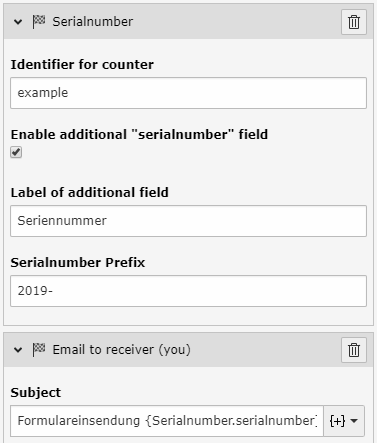
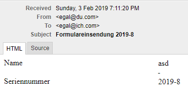
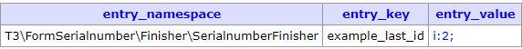

# TYPO3 CMS: Form Framework - Serialnumber Finisher

Provides serialnumber finisher for EXT:form

## Features

* Adds finisher to EXT:form to generate serial numbers, which can be used in further finishers
* Serial numbers can get prefixed for output
* Current index/counter is stored in sys_registry
* You can reuse the same counter in different forms


## Screenshots

Any form with this serialnumber finisher configured




get unique serialnumber, you can use in output and other finishers




## Requirements

* PHP 8.1 or higher
* TYPO3 CMS 12.4, 13.4, or 14.3
* EXT:form installed


## Installation

1. Just install the extension in TYPO3.
2. Register the form configuration:
   * **TYPO3 v12/v13:** Add the static include "EXT:form Serialnumber Finisher" to your TypoScript template.
   * **TYPO3 v14:** The configuration is automatically discovered through
     `Configuration/Form/Serialnumber/config.yaml`. No static TypoScript include is needed.
3. Clear the system caches.


## Using the finisher

### Configuration

The serialnumber finisher has some options you can use:

* **identifier** *(string)* Defines the name of the counter to use. With this option you can reuse the same counter in different forms, if you want.
* **addField** *(boolean)* When enabled a field is dynamically added to form runtime.
* **fieldLabel:** *(string)* Label of this field.
* **prefix:** *(string)* Set before current index. e.g "2019-" would provide "2019-123" serial number.

Also you can override the finisher settings in Flexform of form plugin content element, when you enable the
"Override finisher settings" checkbox.


### Variables

The serialnumber finisher provides two variables you can use in further finishers and templates.

```text
{Serialnumber.serialnumber}
{Serialnumber.index}
```

Serialnumber contains configured prefix. Index is the id, stored in sys_registry.


### sys_registry

TYPO3 provides a database table and a simple API to store informations which doesn't worth an own database table.



Here you can modify the value manually.

> **Caution:** The values stored in [sys_registry](https://docs.typo3.org/typo3cms/CoreApiReference/ApiOverview/SystemRegistry/Index.html) are serialized!


## Example finisher configuration

In this configuration we use the `{Serialnumber.serialnumber}` variable from the previously configured
serialnumber finisher. Also because we've enabled the **addField** option, the mail will contain the
serialnumber as additional field.

```yaml
finishers:
  -
    options:
      identifier: example
      addField: true
      fieldLabel: Seriennummer
      prefix: 2019-
    identifier: Serialnumber
  -
    options:
      subject: 'Formulareinsendung {Serialnumber.serialnumber}'
      recipientAddress: egal@ich.com
      recipientName: Ich
      senderAddress: egal@du.com
      senderName: Du
      replyToAddress: ''
      carbonCopyAddress: ''
      blindCarbonCopyAddress: ''
      format: html
      attachUploads: true
      translation:
        language: ''
    identifier: EmailToReceiver
```


## Sponsor

This extension has been sponsored by:


**zazudesign - die Schwarzwald Werbeagentur in Berlin**

Digitalisierung, Projektierung digitaler Plattformen, Filmproduktion und TYPO3

* Web: https://www.zazudesign.de
* Email: thomas.hezel@zazudesign.de


## Links

* [Source code](https://github.com/a-r-m-i-n/form_serialnumber)
* [Packagist](https://packagist.org/packages/t3/form-serialnumber)
* [TER](https://extensions.typo3.org/extension/form_serialnumber)
* [Sponsor](https://www.zazudesign.de)
