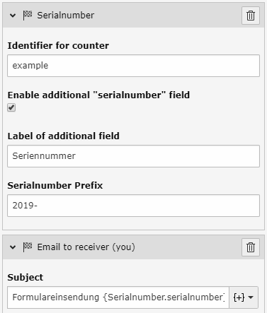
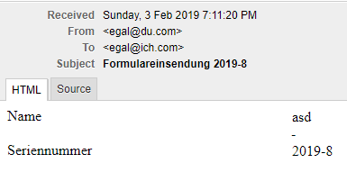
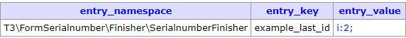

TYPO3 CMS: Form Framework - Serialnumber Finisher
=================================================

Provides serialnumber finisher for EXT:form

Features
--------

* Adds finisher to EXT:form to generate serial numbers, which can be used in further finishers
* Serial numbers can get prefixed for output
* Current index/counter is stored in sys_registry
* You can reuse the same counter in different forms

Screenshots
-----------

Any form with this serialnumber finisher configured

get unique serialnumber, you can use in output and other finishers

Requirements
------------

* TYPO3 9.5
* EXT:forms installed

Installation
------------

Just install the extension in TYPO3.

In your TypoScript Template you need to add the static includes "EXT:form Serialnumber Finisher", before you can
add the serialnumber finisher in your forms.

Clear the system caches.

Using the finisher
------------------

Configuration
^^^^^^^^^^^^^

The serialnumber finisher has some options you can use:

* **identifier** *(string)* Defines the name of the counter to use. With this option you can reuse the same counter in different forms, if you want.
* **addField** *(boolean)* When enabled a field is dynamically added to form runtime.
* **fieldLabel:** *(string)* Label of this field.
* **prefix:** *(string)* Set before current index. e.g "2019-" would provide "2019-123" serial number.

Variables
^^^^^^^^^

The serialnumber finisher provides two variables you can use in further finishers and templates.

::

    {Serialnumber.serialnumber}
    {Serialnumber.index}

Serialnumber contains configured prefix. Index is the id, stored in sys_registry.

sys_registry
^^^^^^^^^^^^

TYPO3 provides a database table and a simple API to store informations which doesn't worth an own database table.

Here you can modify the value manually.

.. caution::
   The values stored in sys_registry are serialized!

Example finisher configuration
------------------------------

In this configuration we use the `{Serialnumber.serialnumber}` variable from the previously configured
serialnumber finisher. Also because we've enabled the **addField** option, the mail will contain the
serialnumber as additional field.

::

    finishers:
      -
        options:
          identifier: example
          addField: true
          fieldLabel: Seriennummer
          prefix: 2019-
        identifier: Serialnumber
      -
        options:
          subject: 'Formulareinsendung {Serialnumber.serialnumber}'
          recipientAddress: egal@ich.com
          recipientName: Ich
          senderAddress: egal@du.com
          senderName: Du
          replyToAddress: ''
          carbonCopyAddress: ''
          blindCarbonCopyAddress: ''
          format: html
          attachUploads: true
          translation:
            language: ''
        identifier: EmailToReceiver

Links
-----

* Source code: https://bitbucket.org/t---3/form_serialnumber
